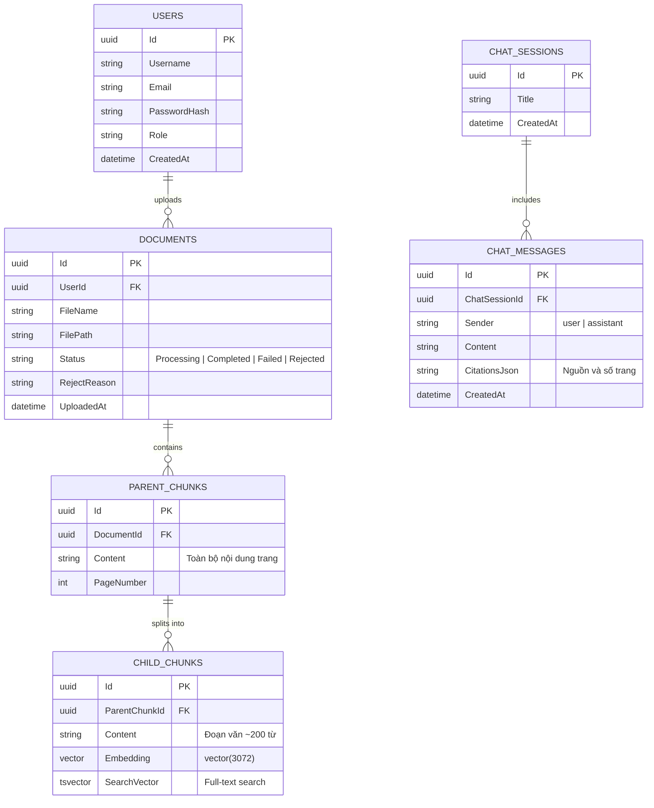

# 📚 THƯ VIỆN MỞ - HỆ THỐNG TRỢ LÝ TRA CỨU & KHAI THÁC TRI THỨC TÀI LIỆU THÔNG MINH (SMART DOCUMENT RAG)

> **Dự án Hệ thống Quản trị & Trợ lý Tra cứu Tài liệu Học thuật Ứng dụng Kỹ thuật RAG (Retrieval-Augmented Generation) Đa Tầng**  
> *Phát triển trên nền tảng .NET 10, PostgreSQL (pgvector), Hangfire và Google Gemini API.*

---

## 🌟 1. Giới Thiệu Dự Án

**Thư Viện Mở (Smart Document RAG)** là giải pháp toàn diện cho việc số hóa, quản lý và khai thác tri thức từ kho tài liệu PDF học thuật. Hệ thống ứng dụng kiến trúc **RAG (Retrieval-Augmented Generation)** tiên tiến để biến các tài liệu tĩnh thành nguồn dữ liệu tương tác thông minh, giúp người dùng tra cứu chính xác, hỏi đáp ngữ cảnh, ôn luyện kiến thức và tóm tắt nội dung tự động.

### Điểm nổi bật của hệ thống:
- **Kiến trúc Chunking 2 cấp (Parent-Child Retrieval):** Tối ưu hóa giữa độ chính xác khi tìm kiếm vector (Child Chunk ~200 từ) và độ phong phú ngữ cảnh cho LLM (Parent Chunk ~1 trang tài liệu).
- **Hybrid Search & RRF (Reciprocal Rank Fusion):** Kết hợp đồng thời sức mạnh của Vector Search (Cosine Similarity) và Keyword Search (PostgreSQL Full-Text Search qua `tsvector`) để đạt độ liên quan cao nhất.
- **Xử lý tác vụ nền phi đồng bộ (Background Job):** Tải lên các tệp tài liệu PDF dung lượng lớn mà không làm gián đoạn hay treo giao diện nhờ Hangfire Worker.
- **Kiểm duyệt an toàn nội dung (Content Moderation):** Cơ chế tự động quét nội dung mẫu của tài liệu qua AI trước khi xử lý nhằm loại bỏ các nội dung bạo lực, phản cảm hoặc vi phạm tiêu chuẩn học thuật.
- **Hỗ trợ Streaming thời gian thực (SSE - Server-Sent Events):** Câu trả lời từ AI được truyền phát từng từ trực tiếp đến giao diện người dùng, mang lại trải nghiệm nhanh và mượt mà.
- **Bộ công cụ học tập thông minh:** Tự động tạo bài thi trắc nghiệm (AI Quiz), tóm tắt tài liệu đa phong cách, và hỏi đáp tài liệu nhanh không lưu trữ (Ephemeral Chat).

---

## 🏗️ 2. Kiến Trúc & Công Nghệ Sử Dụng

### 2.1. Ngăn Xếp Công Nghệ (Tech Stack)

| Thành phần | Công nghệ / Thư viện | Vai trò |
| :--- | :--- | :--- |
| **Backend Framework** | .NET 10 (C# 13, ASP.NET Core) | Xây dựng Web API & Razor Views (MVC) |
| **Database & Vector Store** | PostgreSQL 16 + `pgvector` Extension | Lưu trữ quan hệ, Vector Embeddings (`vector(3072)`) & Full-Text Search (`tsvector`) |
| **ORM** | Entity Framework Core 10 | Quản lý schema, migrations và truy vấn dữ liệu |
| **Background Processing** | Hangfire (PostgreSql Storage) | Xử lý bóc tách PDF, chunking và embedding ngầm |
| **PDF Extraction** | UglyToad.PdfPig | Trích xuất văn bản và số trang trực tiếp từ file PDF |
| **AI / LLM Provider** | Google Gemini API | Model Embeddings (`text-embedding-004`/`gemini-embedding-001`) & Model Chat (`gemini-3.5-flash`/`gemini-1.5-flash`) |
| **Frontend Architecture** | ASP.NET Core MVC Razor Views | Giao diện Academic Responsive, CSS Variables, Bootstrap Icons, Pure Vanilla JS |
| **Tài liệu API** | Swagger / OpenAPI | Kiểm thử và tài liệu hóa các Endpoints RESTful |

---

### 2.2. Luồng Xử Lý & Kiến Trúc Dữ Liệu (RAG Flow)

```mermaid
flowchart TD
    subgraph INGESTION["1. Quy Trình Xử Lý Tài Liệu (Background Job)"]
        A[Người dùng Upload File PDF] --> B[Lưu tạm & Tạo Document 'Processing']
        B --> C[Hangfire Background Job]
        C --> D{Kiểm duyệt nội dung với Gemini}
        D -- Vi phạm --> D1[Đổi Status 'Rejected', Xóa file]
        D -- An toàn --> E[Bóc tách text từng trang qua PdfPig]
        E --> F[Tạo ParentChunk theo từng trang]
        F --> G[Tách thành ChildChunks ~200 từ]
        G --> H[Gọi Gemini Embedding API]
        H --> I[Lưu Vector & tsvector vào PostgreSQL pgvector]
        I --> J[Đổi Status 'Completed']
    end

    subgraph RETRIEVAL["2. Quy Trình Tìm Kiếm & Hỏi Đáp (Hybrid Search RAG)"]
        K[Người dùng đặt câu hỏi] --> L[Gemini Embedding cho Query]
        L --> M1[Dense Vector Search - Cosine Distance]
        K --> M2[Sparse Full-Text Search - tsvector]
        M1 & M2 --> N[Hợp nhất bằng thuật toán RRF - Reciprocal Rank Fusion]
        N --> O[Truy xuất các ParentChunks ngữ cảnh đầy đủ]
        O --> P[Ghép Lịch sử Hội thoại + Ngữ cảnh + Câu hỏi]
        P --> Q[Gửi Prompt tới Gemini Chat LLM]
        Q --> R[Stream phản hồi SSE kèm Trích dẫn Trang PDF]
    end
```



---

## 📦 3. Mô Hình Dữ Liệu (Database Schema)

Dự án sử dụng cơ chế liên kết phân tầng chặt chẽ bảo toàn ngữ cảnh:



---

## 🚀 4. Các Tính Năng Chính Của Hệ Thống

### 1. Quản lý Tài liệu & Kiểm Duyệt Tự Động
- Quản lý kho tài liệu chung của thư viện và khu vực **"Tài liệu của tôi"** dành riêng cho cá nhân.
- Tải lên file PDF với thanh tiến trình trực quan, xử lý ngầm qua Hangfire tránh đơ nghẽn hệ thống.
- **AI Content Moderation:** Đánh giá an toàn nội dung, tự động ngăn chặn và loại bỏ tài liệu chứa nội dung độc hại, bạo lực hay vi phạm.

### 2. Xem Trực Tuyến & Hỏi Đáp Đa Lượt (Multi-turn RAG Chat)
- Xem trực tiếp tài liệu PDF thông qua khung Viewer trực quan song song với giao diện Chat.
- Hỏi đáp theo ngữ cảnh tài liệu; AI trả lời có căn cứ trích dẫn nguồn (tên tài liệu, đoạn trích và số trang).
- Hỗ trợ lưu trữ phiên trò chuyện (`ChatSession`), duy trì ngữ cảnh các câu hỏi kế tiếp.
- Truyền phát câu trả lời thời gian thực với công nghệ **Streaming SSE**.

### 3. Bộ Đề Thi Trắc Nghiệm Tự Động (AI Quiz Generator)
- Tự động phân tích nội dung tài liệu để sinh bộ câu hỏi trắc nghiệm khách quan (4 phương án A, B, C, D).
- Giao diện làm bài trực tuyến, chấm điểm tức thì kèm lời giải thích chi tiết cho từng câu hỏi.
- **Tạo Quiz Nhanh Độc Lập (Standalone Quiz):** Cho phép tải lên tệp PDF bất kỳ để sinh đề thi ngay mà không cần lưu vào thư viện chung.

### 4. Tóm Tắt Tài Liệu Đa Phong Cách (Document Summarization)
- Trích xuất luận điểm và ý chính của toàn bộ văn bản.
- Hỗ trợ 3 phong cách tóm tắt:
  - **Gạch đầu dòng (Bullets):** Ngắn gọn, súc tích, dễ nắm bắt.
  - **Ý chính cốt lõi (Key Takeaways):** Làm nổi bật các điểm mấu chốt.
  - **Đoạn văn học thuật (Academic Paragraph):** Văn phong mạch lạc, học thuật sâu sắc.
- Hỗ trợ cả tài liệu lưu trữ sẵn và **Tóm tắt nhanh độc lập (Standalone Summary)** từ tệp tải lên tức thì.

### 5. Hỏi Đáp Nhanh Tạm Thời (Ephemeral Chat)
- Tính năng trò chuyện chớp nhoáng với tài liệu tạm: Bóc tách, tạo vector và trao đổi với tài liệu ngay lập tức.
- Tự động giải phóng bộ nhớ và dọn dẹp file tạm sau khi kết thúc phiên làm việc.

### 6. Tìm Kiếm & Đề Xuất Thông Minh (Search & Auto-suggestions)
- Tìm kiếm tức thì với công nghệ Hybrid Search (Từ khóa + Ngữ nghĩa Vector).
- API hỗ trợ gợi ý từ khóa tìm kiếm (`/api/Document/suggestions`).

---

## 📁 5. Cấu Trúc Thư Mục Dự Án

```plaintext
ragdocument/
├── Controllers/
│   ├── AccountController.cs          # Quản lý Đăng nhập, Đăng ký, Đăng xuất, Session
│   └── DocumentController.cs         # Xử lý Views MVC và toàn bộ RESTful API cho RAG/Quiz/Summary
├── Data/
│   └── ApplicationDbContext.cs       # Cấu hình EF Core, pgvector, tsvector, quan hệ bảng
├── DTOs/
│   ├── ChatDto.cs                    # DTO cho ChatRequest, ChatResponse, Citations
│   ├── QuizsDto.cs                   # DTO cho Quiz Generation (câu hỏi, đáp án, giải thích)
│   └── SearchResultDto.cs            # DTO trả về kết quả tìm kiếm Hybrid Search & điểm RRF
├── Migrations/                       # Lịch sử EF Core Database Migrations
├── Models/
│   ├── User.cs                       # Thông tin tài khoản người dùng
│   ├── Document.cs                   # Bản ghi tài liệu tải lên
│   ├── ParentChunk.cs                # Đoạn văn bản cấp cha (theo trang)
│   ├── ChildChuck.cs                 # Đoạn văn bản cấp con lưu Vector Embedding
│   ├── ChatSession.cs                # Phiên hội thoại hỏi đáp
│   └── ChatMessage.cs                # Chi tiết tin nhắn kèm trích dẫn
├── Properties/
│   └── launchSettings.json           # Cấu hình cổng chạy ứng dụng
├── Services/
│   ├── IGeminiService.cs             # Interface kết nối Gemini API
│   ├── GeminiService.cs              # Triển khai Embedding, Chat Stream, Quiz, Kiểm duyệt
│   ├── IRetrievalService.cs          # Interface tìm kiếm
│   ├── RetrievalService.cs           # Triển khai Hybrid Search & RRF Algorithm
│   ├── IChatRAGService.cs            # Interface RAG Chat
│   ├── ChatRAGService.cs             # Quản lý phiên, trích xuất ngữ cảnh và sinh câu trả lời
│   └── DocumentProcessingJob.cs      # Hangfire Job bóc tách PDF, kiểm duyệt, chunking
├── Views/                            # Giao diện người dùng Razor Views
│   ├── Account/
│   │   ├── Login.cshtml              # Trang đăng nhập
│   │   └── Register.cshtml           # Trang đăng ký tài khoản
│   ├── Document/
│   │   ├── Index.cshtml              # Trang chủ: Kho tài liệu & Tìm kiếm chung
│   │   ├── List.cshtml               # Danh sách tài liệu của người dùng
│   │   ├── Details.cshtml            # Chi tiết tài liệu, PDF Viewer & RAG Chat Stream
│   │   ├── Quiz.cshtml               # Làm bài trắc nghiệm theo tài liệu
│   │   ├── Summary.cshtml            # Xem tóm tắt tài liệu
│   │   ├── StandaloneQuiz.cshtml     # Tạo Quiz nhanh từ file tạm
│   │   ├── StandaloneSummary.cshtml  # Tóm tắt nhanh từ file tạm
│   │   ├── EphemeralChat.cshtml      # Hỏi đáp nhanh không lưu phiên
│   │   └── Upload.cshtml             # Giao diện tải tài liệu lên thư viện
│   └── Shared/
│       └── _Layout.cshtml            # Giao diện khung chuẩn (Topbar, Hamburger Drawer, Footer)
├── appsettings.example.json          # Mẫu cấu hình mẫu
├── appsettings.json                  # File cấu hình cấu trúc thực tế (Connection string, API key)
├── Program.cs                        # Khởi tạo DI, Pipeline, DbContext, Hangfire, Session
└── SmartDocumentRAG.API.csproj       # File định nghĩa gói thư viện & Target .NET 10
```

---

## 🐳 6. Hướng Dẫn Chạy Bằng Docker Compose

Docker Compose chạy ứng dụng ASP.NET Core và PostgreSQL có `pgvector` cùng nhau. Ứng dụng chạy ở cổng `8080`; PostgreSQL được mở ở cổng `5433` trên máy host để có thể kết nối bằng DBeaver. Giữa hai container, web kết nối database bằng hostname `db` và cổng nội bộ `5432`.

### 6.1. Yêu cầu

- Docker Desktop đã cài và đang chạy (Docker Compose được tích hợp sẵn).
- .NET SDK 10 để áp dụng EF Core migrations khi khởi tạo database mới.
- Google Gemini API key để sử dụng các chức năng AI. Có thể tạo key tại [Google AI Studio](https://aistudio.google.com/).

Không cần cài PostgreSQL riêng và không cần chạy ứng dụng bằng `dotnet run`.

### 6.2. Tạo file môi trường

Mở PowerShell tại thư mục chứa `compose.yaml` và `Dockerfile`:

```powershell
cd D:\hoclaptrinh\Source\SmartDocumentRAG.API\SmartDocumentRAG.API
if (-not (Test-Path .env)) { Copy-Item .env.example .env }
notepad .env
```

Nếu `.env` đã tồn tại, lệnh trên giữ nguyên file và chỉ mở nó để bạn kiểm tra hoặc bổ sung biến còn thiếu.

Trong `.env`, đặt giá trị riêng cho máy của bạn:

```dotenv
POSTGRES_DB=smartdocumentrag
POSTGRES_USER=raguser
POSTGRES_PASSWORD=thay-bang-mat-khau-dai-va-ngau-nhien
GEMINI_API_KEY=dan-gemini-api-key-cua-ban
GEMINI_EMBEDDING_MODEL=gemini-embedding-001
GEMINI_CHAT_MODEL=gemini-3.5-flash
```

`.env` chứa mật khẩu và API key, đã được Git bỏ qua; không commit file này. Chỉ commit `.env.example` làm mẫu.

### 6.3. Khởi động PostgreSQL

```powershell
docker compose up -d db
docker compose ps
```

Chờ service `db` có trạng thái `healthy` trước khi chuyển sang bước tiếp theo.

### 6.4. Tạo schema database lần đầu

Ứng dụng không tự chạy EF migrations khi khởi động. Cài EF Core CLI một lần nếu máy chưa có:

```powershell
dotnet tool install --global dotnet-ef --version 10.0.12
```

Đọc thông tin DB từ `.env`, tạm đặt connection string cho lệnh migration, rồi áp dụng schema:

```powershell
$envValues = @{}
Get-Content .env | ForEach-Object {
    if ($_ -match '^\s*([^#=]+)=(.*)$') {
        $envValues[$Matches[1].Trim()] = $Matches[2].Trim()
    }
}

$env:ConnectionStrings__DefaultConnection = "Host=localhost;Port=5433;Database=$($envValues['POSTGRES_DB']);Username=$($envValues['POSTGRES_USER']);Password=$($envValues['POSTGRES_PASSWORD'])"
dotnet ef database update
Remove-Item Env:ConnectionStrings__DefaultConnection
```

Chạy lệnh tại thư mục chứa `SmartDocumentRAG.API.csproj`. Lệnh này tạo schema trong database Compose qua cổng host `5433`.

### 6.5. Build và chạy ứng dụng web

```powershell
docker compose up -d --build web
docker compose ps
```

Mở trang đăng nhập tại [http://localhost:8080/Account/Login](http://localhost:8080/Account/Login). Xem log nếu cần:

```powershell
docker compose logs -f web
```

### 6.6. Các lệnh thường dùng

```powershell
# Khởi động cả web và database sau này
docker compose up -d

# Xem trạng thái
docker compose ps

# Theo dõi log
docker compose logs -f

# Dừng container nhưng giữ dữ liệu
docker compose stop

# Xóa container và network; các named volume vẫn được giữ
docker compose down
```

Database và file upload được lưu trong named volumes `postgres_data` và `uploads_data`. Không dùng `docker compose down -v` trừ khi muốn xóa các volume này và dữ liệu bên trong.

Kết nối DBeaver từ máy host: host `localhost`, port `5433`, database/user theo `.env`. Trong connection string bên trong container, hostname DB là `db`, port `5432`.

### 6.7. Chạy trên máy khác hoặc chuyển dữ liệu

Trên máy khác, lấy mã nguồn có `Dockerfile`, `.dockerignore`, `compose.yaml` và `.env.example`, cài Docker Desktop, tạo `.env` riêng rồi thực hiện các bước 6.2–6.5. Database mới sẽ rỗng và cần chạy migrations như bước 6.4.

Named volumes chỉ nằm trên máy đã tạo chúng; chúng không được chuyển theo Git. Nếu cần dữ liệu tài khoản/tài liệu cũ, hãy sao lưu và khôi phục PostgreSQL cùng các file upload riêng. Sao chép source code hoặc chạy Compose không tự chuyển dữ liệu từ máy cũ.

Hangfire Dashboard: `/hangfire` (yêu cầu xác thực). Swagger chỉ bật khi ứng dụng chạy ở môi trường `Development`.

---

## 📡 7. Danh Sách API Chính (Endpoints Reference)

### Xác thực & Tài khoản
- `GET /Account/Login` | `POST /Account/Login`: Đăng nhập hệ thống.
- `GET /Account/Register` | `POST /Account/Register`: Đăng ký tài khoản người dùng mới.
- `GET /Account/Logout`: Đăng xuất, hủy bỏ phiên làm việc.

### Quản lý Tài liệu & Tìm kiếm
- `POST /api/Document/upload`: Tải lên tài liệu PDF mới (Kích hoạt job Hangfire).
- `GET /api/Document/search?query={q}&topK={k}`: Tìm kiếm đoạn văn bản bằng Hybrid Search (RRF).
- `GET /api/Document/suggestions?query={q}`: Gợi ý các tên tài liệu phù hợp theo từ khóa.
- `GET /api/Document/view/{id}`: Xem file PDF trực tuyến trên trình duyệt.

### Hỏi Đáp RAG (Chatbot)
- `POST /api/Document/chat`: Hỏi đáp đa lượt đồng bộ.
- `POST /api/Document/chat-stream`: Hỏi đáp đa lượt với Server-Sent Events (SSE) theo thời gian thực.
- `GET /api/Document/sessions`: Lấy danh sách các phiên trò chuyện.
- `GET /api/Document/sessions/{sessionId}/messages`: Lấy lịch sử tin nhắn của một phiên.

### Ứng dụng Học tập AI
- `POST /api/Document/generate-quiz`: Tạo câu hỏi trắc nghiệm từ tài liệu đã vector hóa.
- `POST /api/Document/generate-standalone-quiz`: Tạo câu hỏi trắc nghiệm từ file tải lên tạm thời.
- `POST /api/Document/summarize`: Tóm tắt nội dung tài liệu theo phong cách yêu cầu.
- `POST /api/Document/generate-standalone-summary`: Tóm tắt tài liệu nhanh từ file tải lên tạm thời.
- `POST /api/Document/ephemeral/init`: Khởi tạo phiên hỏi đáp tài liệu nhanh tạm thời.
- `POST /api/Document/ephemeral/chat-stream`: Chat stream trên tài liệu tạm.
- `DELETE /api/Document/ephemeral/cleanup/{id}`: Dọn dẹp tài liệu và dữ liệu phiên tạm thời.

---

## 👥 8. Đội Ngũ Phát Triển Dự Án

Dự án được xây dựng và hoàn thiện bởi các thành viên:

| Họ và Tên | Vai trò | Liên hệ |
| :--- | :--- | :--- |
| **Triệu Tuấn Duy** | Backend Developer / Architecture | [Facebook](https://web.facebook.com/duyga123) • SĐT: `0971358660` |
| **Ngô Vương Linh** | AI Integration & Fullstack Developer | [Facebook](https://web.facebook.com/vuong.linh.303497) |
| **Lê Như Bảo** | Frontend / UI-UX Academic Designer | [Facebook](https://web.facebook.com/le.nhu.bao.656010) |

---

## 📜 9. Giấy Phép & Bản Quyền

Dự án thuộc bản quyền của nhóm tác giả **Thư Viện Mở**. Được phát triển phục vụ mục đích nghiên cứu học thuật, chia sẻ tri thức và xây dựng ứng dụng AI hiện đại trong giáo dục.
